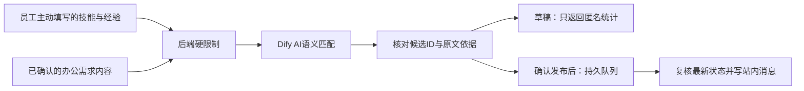

# AI人员匹配与站内推荐

员工档案以本地SQLite为唯一数据源。`skills`保留技能标签，新增`skillDescription`供员工明确描述经验、工具与能解决的问题（最长2000字）。界面会说明用于AI匹配，不自动把私人`bio`或心理对话当作技能描述，也不把人员放入共享知识库。

## 处理流程

后端先检查互助意愿、推荐开关、当前接取负载和北京时间空闲时段。这些是硬限制，模型无法绕过。未选择具体空闲日只标记待双方确认，不把自由文字推断成确定排期；过期或明确时段不足15分钟不推荐。接取、待验收和退回修改均计负载。

AI看到需求标题、困扰、目标、交付和技能，以及候选匿名ID、技能标签及主动提供的经验说明。没有姓名、部门、个人简介、联系方式、附件或私密聊天。Dify准备节点再次硬过滤，提供给LLM的候选正文只包含能力字段。模型按具体任务判断可迁移经验，例如“用pandas读取xlsx并比较ID”可匹配数据核对，即使标签仅写“程序开发”。明确否定的能力、只会录入而不会编程不能推断成自动化能力。

每批24人，最多2批并发，模型每批最多挑8位真正相关的候选，65分以下或证据不足不推荐，不凑人数。工作流和后端都核对ID范围、分数、字段类型和`evidence`是否为该候选提供的原文片段；不接受编造资质或虚构依据。分数仅为本次任务相关性的排序规则，不是员工绩效、医疗资质或成功概率。心理治疗、危机支持不走员工匹配。

后端再次按最新档案/负载/任务状态复核，语义分相同时优先时间已登记、负载较低者。能力判断最多缓存1小时，缓存键包括需求内容、候选能力文字、应用密钥作用域与策略版本；不缓存整个员工档案。档案/需求改变会换缓存键，时间/意愿等硬限制每次重新计算，不能用旧结果绕过。

## 队列、消息与限频

制作卡片只预匹配，`sent=false`，不返回人员姓名。本人确认发布后才进入持久队列，公司可见、未移除、未接取、未过期的真实任务才能通知，演示与公告不通知。没有合适人选时需求仍在公屏，后台继续补查。

发布/修改公开需求、注册/更新档案即时入队；每5秒检查重试任务，每15分钟补查开放任务。不创建隐藏聊天，也不依赖用户保持窗口。服务停止不推送，重启恢复。运行期间需求或档案改变会重新排队，避免丢触发。

每次最多通知5人，每人每天最多3条（北京时间），同用户/需求/类型唯一约束避免重复；已收过消息或达到接收额度的人不再耗费本轮模型评估。队列240秒租约、网络调用总预算180秒、单次Workflow90秒，失败退避重试；已配置AI但失败时不静默伪装为本地结果。未配置Workflow Key时仍明确使用原标签规则，method=rules，不宣称语义理解。

消息仅保存收件人、需求ID、理由、创建/已读时间。仅本人可读，标题与状态读取当前需求，不复制心理聊天。已下架只显示失效说明。网页15秒拉取；个人可关闭意愿或推荐。无站外/系统推送。

## Dify配置

现有工作流保留原app ID和Key，扩展为两个独立分支：

- `snapshot_json` → 硬过滤 → LLM语义匹配 → 严格ID/证据校验 → `matches_json`。
- `review_json` → 限定待发布文字 → LLM内容审核 → 严格布尔校验 → `review_result_json`。

生成器为`scripts/build-matching-workflow.mjs`，执行`node scripts/build-matching-workflow.mjs`更新`docs/dify-matching-workflow.yml`。导入应覆盖原app，不新建重复app。使用本机已有DeepSeek V4.1 Flash模型供应商；模型凭证不在DSL中。生成后须核对节点和真实API并发布；更换模型/规则后提升`.env`的`DIFY_MATCHING_POLICY_VERSION`以使旧缓存失效。

`.env`中专用`DIFY_MATCHING_API_KEY`与`DIFY_MATCHING_BASE_URL`继续复用，不是聊天Agent密钥。`preview_matches`工具接受本轮10分钟`match_token`与卡片摘要，新增困扰/目标/交付字段，仍兼容旧字段。工具路径只按原代理精确放行，不能扩大成整个内网。Agent的care分流不调用匹配，关怀区也不产生匹配任务。

## 验证与限制

`server-tests/semantic-matching.test.mjs`覆盖跨标签而不按词淘汰、硬过滤前置、真实证据/ID/阈值、缓存与能力更新、50人分批、审核失败关闭、导出节点可运行。真实Workflow及网站合成测试中，pandas经验候选被选，绘画/不愿互助/接单满/无空闲被排除；发布后唯一合适人员收到真实消息。

模型判断仍有不确定性，匹配不等于资质认证，接取由本人决定。当前上限2000候选、每轮20个队列任务，未做企业级压测或分布式调度。公司身份认证、数据保留策略和人工关怀流程需在公网部署前按实际组织配置。
