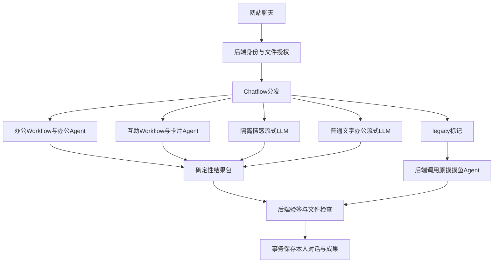

# 多Agent入口与回退

状态：2026-11-05已在本机启用办公、卡片及独立情感支持三个分支，原摸摸鱼Agent保留。公开应用标识见dify-config/multi-agent-apps.json，关怀协议与边界见CARE-AGENT.md，验收记录见VALIDATION.md。

入口#4增加两条直接流式路径：无文件的文字办公走office_chat，无工具情感对话走care。文件/已有成果继续交给办公Workflow，制卡仍交给卡片Workflow；两个快分支不启动Agent沙箱。原情感Agent/Workflow仍保留，旧发布版本可以恢复。下面的专业Workflow协议继续适用于文件任务和旧版本。

## 执行路径

网站继续调用本项目后端。后端上传本人授权材料和本轮私密上下文文件，再调用Chatflow；Chatflow只路由和拼装结果，不自主发布或通知。



办公Agent仅挂office-file-work/document-quality-work及四个文档工具；卡片Agent挂需求澄清/制卡Skill与design_card、preview_matches；情感Agent只读本人关怀上下文，不挂业务工具。Skill不等于工具权限，办公环境须单独准备并在新任务验证。

## 会话与文件

- Chatflow用active_route会话变量辅助连续任务分发；正式用户历史、卡片与文件仍以本网站数据库为准。上下文文件含完整本轮用户要求、最近业务历史、已确认卡片及真实文件引用，避免新版Agent普通文本变量2000字符摘要截断。路由只收到较短的历史首尾，保留末尾征求转互助同意的问题。
- 新Agent节点每轮独立沙箱。续改从本人、本请求的outputHistory下载真实最新版，另存带本轮output_prefix的文件；不得假设上一轮本地路径存在。
- 专业节点声明answer_json、deliverables(array[file])、artifact_json。文件必须先真实上传，由Dify按租户记录重建File，再经子Workflow和Chatflow输出。网站只接受tool_file映射，从配置的Dify地址获取签名文件，检查本轮前缀、数量/大小/格式后保存私人下载；结果文字不能伪造文件。
- 制卡工件必须通过本轮job_token的HMAC验证。其他用户、过期任务或改造后的工件不展示。生成文件不会因为转互助自动公开，原件共享仍由本人选择并在发布前确认。
- dify_conversations主键从request_id迁移为(request_id,scope)，旧记录在事务中原样复制，新旧入口各保留conversation_id。文件上传缓存也按应用scope与用户分隔；legacy委派重新上传授权输入，不能借用新应用的缓存引用。
- messages.intent区分工作与关怀历史；care分支单独绑定care_context_file，工作分支及路由摘要不接收过去的关怀正文。旧版未标记消息仅保留本人网页显示，不默认提供给新办公/卡片Agent；原成果下载引用仍可用于继续修改。
- 对话、文件和会话引用一起事务提交。并发变更、上游失败、伪造/缺失成果时不覆盖原有内容。

## 配置与回退

```dotenv
# 旧Agent：保持既有值，用作管理员回退和旧协议兼容
DIFY_BASE_URL=http://127.0.0.1:8080/v1
DIFY_API_KEY=
# 新入口：密钥仅保存在本机.env
DIFY_ENTRYPOINT=chatflow
DIFY_CHATFLOW_BASE_URL=http://127.0.0.1:8080/v1
DIFY_CHATFLOW_API_KEY=
```

没有配置新密钥且未指定模式时仍用旧入口；显式选chatflow却缺少密钥会报配置错误。管理员将DIFY_ENTRYPOINT改为legacy并重启网站即可恢复原Agent，原密钥和旧会话不被覆盖。Chatflow返回legacy标记时，后端用旧Agent独立会话执行同一授权请求。新流程出错不自动重复整项办公工作，避免重复生成或工具操作。

健康检查/api/health的difyEntrypoint仅说明当前入口，既不返回密钥也不证明模型任务已验收。发布、接取、验收、正式消息与匹配硬条件保持由后端执行。

## 可复用配置

- scripts/build-multi-agent-chatflow.mjs根据dify-config/multi-agent-apps.json的公开工具标识生成Chatflow DSL；无凭证。
- 当前Dify的Workflow文件参数须同时保留tool_configurations和tool_parameters，并声明tool_node_version=2；只写后者虽能通过数据模型校验，界面会判定必填文件未绑定。真实UI修正导出保存在chatflow-ui.yml。
- 新Agent原生Workflow导出的.ifpkg包含Skill资产，解出的.yml供检查结构。单独DSL不携带办公venv/字体/渲染依赖；导入后应检查Agent引用和工具绑定版本，不能当作完整环境备份。
- 专用提示词和输入输出协议在dify-config/office-agent-prompt.txt、card-agent-prompt.txt及multi-agent-contract.md。迁移不把员工文件、对话Cookie或.env打包进共享资产。

## 验收门槛

真实Word生成→同对话局部修订→旧版及原文保留→本人可下载、其他账号404；办公转互助必须有明确同意，生成私密预览和有效工件，不自动发布或通知。另检查care委派、错误保护、重启续聊与管理员切回旧入口。模型路由和文档检查均可能误判，需要边界测试和有限重试。

本轮合成单页Word两轮耗时约87秒/68秒，转卡约32秒；两次实际视觉工作流均成功，下载后的两份Word独立重渲染并逐页查看，XML确认仅第三段改变且样式不变。真实授权TXT读取和legacy关怀委派通过；31项回归通过，含模拟重启/管理员回退和长上下文。未进行企业并发压力测试，复杂多页文件不在此次完整链路验收范围内。

Dify的UI测试页在可选materials为空时可能出现transfer_method客户端异常；网站真实Service API不带材料的两轮办公已通过。不能据此认定所有UI表单已修复。生成成果仍仅本人下载，转卡不会自动附加到任务材料，需本人下载后上传并确认提供给接取者。
